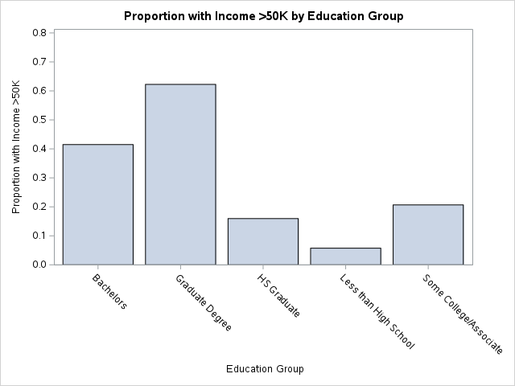
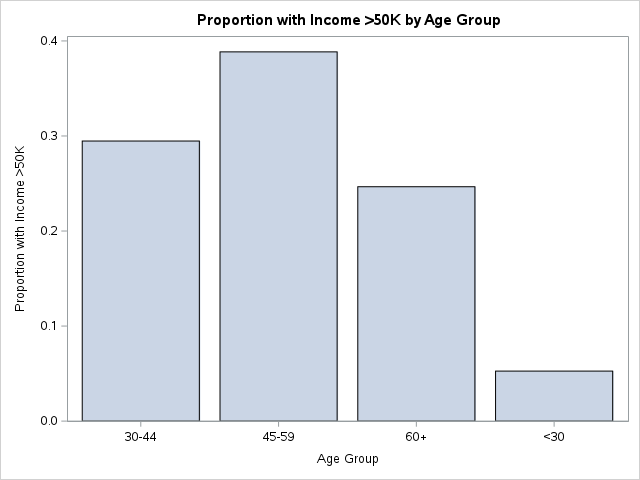
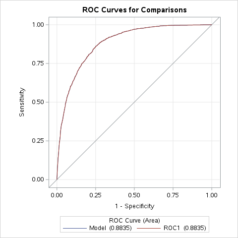
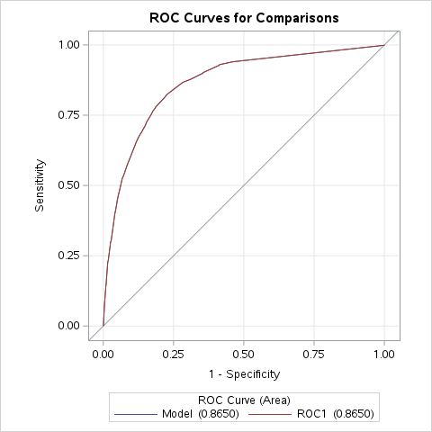

# Census income prediction

Can you predict whether someone earns more than $50,000 a year from their census record? This is a group project for SOR3008 at Queen's University Belfast, using the UCI Adult Census Income dataset, with Jonathan Pegrum. We presented it as three academic posters.

My part was the SAS work: data cleaning, exploratory analysis, a logistic regression and a decision tree. `Census.sas` has the code and `census_income_sas.ipynb` shows it with the results from my run. The poster also compares a random forest, neural network and naive Bayes model from the group's R code, which are not in this repo.

## Results

32,560 records, split 70% training (22,792) and 30% test (9,768). Everything below is on the test set, with a 0.5 cutoff.

| Model | Accuracy | Sensitivity | Specificity | AUC |
|---|---|---|---|---|
| Logistic regression | 83.7% | 55.8% | 92.5% | 0.884 |
| Decision tree | 83.3% | 57.1% | 91.6% | 0.865 |
| Always predict "under $50K" | 76.0% | 0.0% | 100% | 0.500 |

About 76% of people in the test set earn under $50K, so the last row is the score to beat. Both models beat it. Both are good at spotting people under $50K (specificity above 91%) and much weaker at spotting high earners (sensitivity 56 to 57%), because the data has far more people under $50K than over. The logistic regression is slightly ahead on AUC.

In the tree, marital status was the most important variable, followed by years of education, occupation and age group.

## Data preparation

Rows with a blank value in any field were dropped. Values recorded as "?" were kept, and categories were grouped to reduce overfitting (workclass, for example, has a "Missing" group). Group variables were built for age, education, occupation, marital status, race, hours worked and country.

## Limits

Class imbalance is the main issue: the models favor the larger under-$50K group. Things to try next: k-fold cross-validation instead of one split, different probability cutoffs, and interaction terms like education and occupation.

## Files

| File | What it is |
|---|---|
| `Census.sas` | SAS code (my part) |
| `census_income_sas.ipynb` | The same code with the results from my run |
| `Census_Income.pdf` | The three group posters |

## Running it

You need SAS. The dataset is the public UCI Adult Census Income data and is not included here. The code uses a library name and file paths from the university SAS environment, so change those first.
