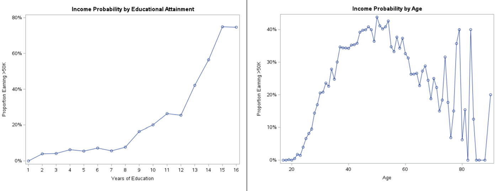
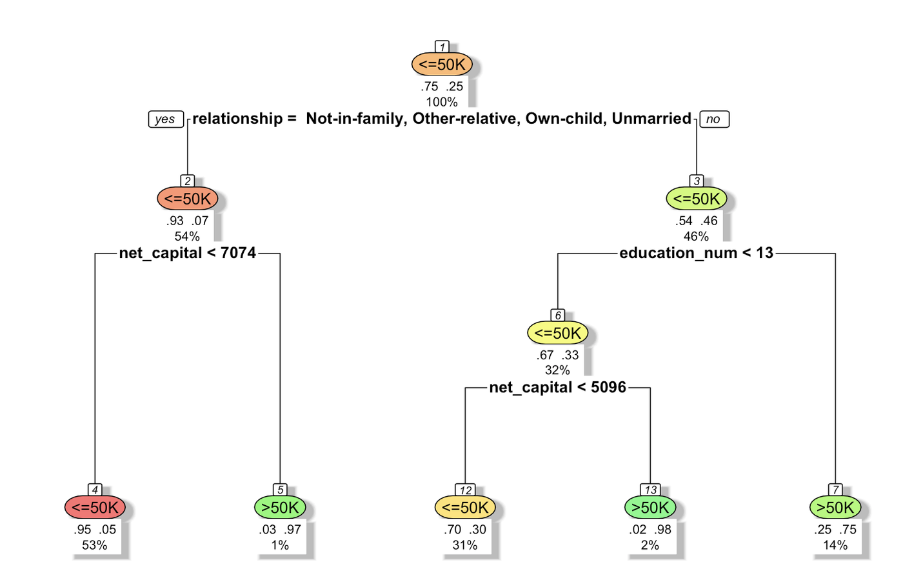
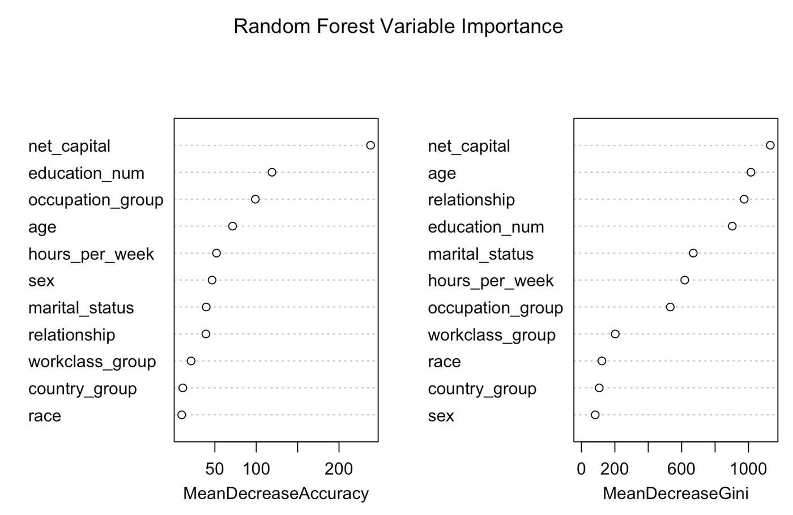

# Census income prediction

Can you predict whether someone earns more than $50,000 a year from their census record? This is a group project for SOR3008 at Queen's University Belfast, using the UCI Adult Census Income dataset, with Jonathan Pegrum. We presented it as three academic posters.

My part was the SAS work. `Census.sas` covers the data cleaning, exploratory analysis, logistic regression and decision tree. The other models in the table below came from the group's R code.

## Results

Test set of 6,033 people.

| Model | Accuracy | Sensitivity | Specificity | AUC |
|---|---|---|---|---|
| Random forest | 85.0% | 60.8% | 92.9% | 0.892 |
| Neural network | 84.0% | 57.4% | 92.7% | 0.901 |
| Decision tree | 83.5% | 49.1% | 94.9% | 0.845 |
| Logistic regression | 82.5% | 52.7% | 92.3% | 0.886 |
| Naive Bayes | 79.6% | 30.3% | 95.8% | 0.864 |
| Always predict "under $50K" | 75.1% | 0.0% | 100% | 0.500 |

About 75% of people in the data earn under $50K, so the last row is the score to beat. Every model beats it, with the random forest best on accuracy and the neural network best on AUC. All of them are very good at spotting people under $50K (specificity above 92%) and much weaker at spotting high earners (sensitivity from 30% to 61%). Naive Bayes is the weakest, probably because it assumes the variables are independent when several of them are clearly related.

Net capital (capital gains and losses combined), relationship status and education came out as the strongest predictors across the models. Logistic regression is the easiest to read, and gives odds ratios for things like occupation.

## Data preparation

About 7% of rows had missing values (in workclass and occupation). I dropped those rows, which leaves 30,162 people. That assumes the values are missing at random, which may not be true. Rare categories were grouped together to reduce overfitting. The data was split 70% training, 10% validation and 20% test.

## Limits

Class imbalance is the main issue, since the models favor the larger under-$50K group. Things we would try next: k-fold cross-validation instead of one split, different probability cutoffs, interaction terms like education and occupation, and keeping the original occupation and country categories instead of grouped ones.

## Files

| File | What it is |
|---|---|
| `Census_Income.pdf` | The three posters |
| `Census.sas` | SAS code (my part) |

## Running it

You need SAS. The dataset is the public UCI Adult Census Income data and is not included here. The code uses a library name and file paths from the university SAS environment, so change those first.
